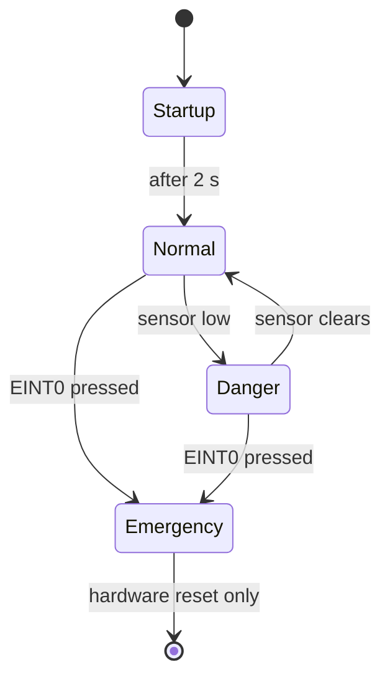

# Industrial Safety System with Emergency Stop using LPC2129

An embedded C project for the **LPC21xx ARM7** microcontroller family (e.g. LPC2129) that runs a motor and shuts it down automatically when a safety sensor detects danger or an emergency-stop button is pressed. System status is shown on a 16×2 LCD and a warning LED.

## Features

- **Automatic danger detection** — the motor stops the moment the safety sensor is triggered, and restarts once the area is clear
- **Interrupt-driven emergency stop** — a button on `EINT0` cuts the motor instantly from the interrupt routine, without waiting for the main loop
- **Latched emergency state** — after an e-stop the system stays halted until a hardware reset, as a real e-stop should
- **Live status display** on a 16×2 character LCD
- **Visual warning LED** for danger and emergency states

## Hardware

| Component | Notes |
|---|---|
| LPC21xx development board | Code uses `LPC21XX.H` (Keil) |
| 16×2 character LCD (HD44780-compatible) | 8-bit mode |
| Digital safety sensor | Active-low output, e.g. an IR obstacle sensor |
| DC motor + driver | L293D or similar H-bridge |
| LED | Wired active-low |
| Push button | Emergency stop, on EINT0 |

## Pin Map

All connections are on **Port 0**.

| Pin | Function | Logic |
|---|---|---|
| P0.0 – P0.7 | LCD data lines D0–D7 | — |
| P0.8 | LCD RS | — |
| P0.9 | LCD E | — |
| P0.10 | Safety sensor input | `0` = danger detected |
| P0.11 | Warning LED | `0` = LED on |
| P0.12 | Motor driver IN1 | — |
| P0.13 | Motor driver IN2 | — |
| P0.14 | Motor driver EN | — |
| P0.16 | Emergency button (EINT0) | Falling-edge interrupt |

## How It Works

On power-up the LCD shows **INDUSTRIAL / SAFETY SYSTEM** for 2 seconds, then the system runs in one of three states:

| State | Trigger | Motor | LED | LCD |
|---|---|---|---|---|
| **Normal** | Sensor high | Running | Off | `NORMAL` / `MOTOR RUNNING` |
| **Danger** | Sensor low | Stopped | On | `DANGER` / `MOTOR STOPPED` |
| **Emergency** | E-stop button pressed | Stopped | On | `EMERGENCY` / `MOTOR STOPPED` |



The **Danger** state recovers on its own when the sensor clears. The **Emergency** state does not — it latches until the board is reset.

### Emergency stop interrupt

`EINT0` on P0.16 is configured as an edge-triggered, falling-edge interrupt and mapped to vectored IRQ slot 0 (VIC channel 14). The ISR:

1. Sets the `emergency` flag
2. Turns the motor off and the LED on immediately
3. Clears the interrupt flag (`EXTINT`) and acknowledges the VIC (`VICVectAddr = 0`)

## Project Structure

```
├── main.c     # Application logic, motor/LED/sensor control, EINT0 setup and ISR
├── lcd.h      # 16×2 LCD driver (8-bit mode)
└── delay.h    # Millisecond and second delays using Timer0
```

## Building and Flashing

1. Create a new project in **Keil µVision** and select your LPC21xx device.
2. Add `main.c` to the project and keep `lcd.h` and `delay.h` in the same folder.
3. Build the project to generate a `.hex` file (enable *Create HEX File* under Options for Target → Output).
4. Flash the `.hex` to the board using **Flash Magic** over UART/ISP.

### Clock assumption

`delay.h` sets the Timer0 prescaler for a **15 MHz peripheral clock** (60 MHz CPU clock with VPB divider 4). If your board runs at a different clock, adjust `T0PR` in `delay_ms()` and `delay_second()` or all timings will be off.

## Known Limitations

- **E-stop race window:** if the button is pressed between the main loop's emergency check and its `Motor_ON()` call, the motor can restart for up to ~500 ms before the loop catches the flag. A guard inside `Motor_ON()` — `if (emergency) return;` — closes this.
- **LCD init sequence:** function set (`0x38`) should be sent first, after a power-on delay, and the entry-mode command (`0x06`) is missing. The display works on most modules but isn't guaranteed across all of them.
- **Screen flicker:** the LCD is cleared and redrawn every 500 ms even when the state hasn't changed.
- **Code in headers:** `lcd.h` and `delay.h` contain function definitions and have no include guards, so they can only be included from one `.c` file.

## Future Improvements

- Close the e-stop race condition
- Redraw the LCD only on state change
- Split drivers into `.c` / `.h` pairs with include guards
- Add a buzzer for audible alerts
- Add a reset/acknowledge button so the emergency state can be cleared without a full board reset
