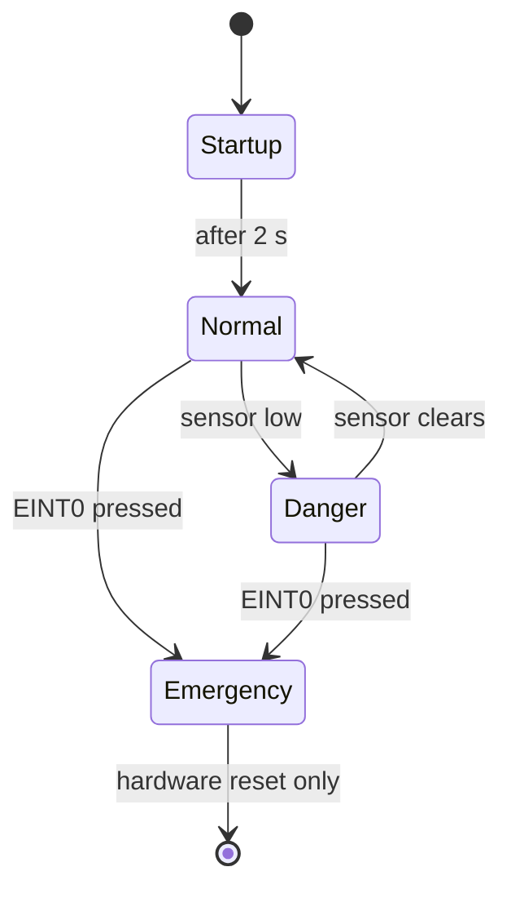

# Industrial Safety System with Emergency Stop using LPC2129

An embedded C project for the **LPC2129 ARM7** microcontroller that runs a motor and shuts it down automatically when a safety sensor (IR sensor) detects danger or an emergency-stop button is pressed. System status is shown on a 16×2 LCD and a warning LED.

## Features

- **Automatic danger detection** — the motor stops the moment the safety sensor (IR sensor) is triggered, and restarts once the area is clear
- **Interrupt-driven emergency stop** — a button on `EINT0` cuts the motor instantly from the interrupt routine, without waiting for the main loop
- **Latched emergency state** — after an e-stop the system stays halted until a hardware reset, as a real e-stop should
- **Live status display** on a 16×2 character LCD
- **Visual warning LED** for danger and emergency states

## Hardware

| Component | Notes |
|---|---|
| LPC2129 development board | ARM7TDMI-S, programmed with Keil µVision |
| 16×2 character LCD (HD44780-compatible) | 8-bit mode |
| Safety sensor (IR sensor) | Digital, active-low output |
| DC motor + L293D motor driver | — |
| LED | Wired active-low |
| Push button | Emergency stop, on EINT0 |

## Pin Map

All connections are on **Port 0**.

| Pin | Function | Logic |
|---|---|---|
| P0.0 – P0.7 | LCD data lines D0–D7 | — |
| P0.8 | LCD RS | — |
| P0.9 | LCD E | — |
| P0.10 | Safety sensor (IR sensor) input | `0` = danger detected |
| P0.11 | Warning LED | `0` = LED on |
| P0.12 | L293D IN1 | — |
| P0.13 | L293D IN2 | — |
| P0.14 | L293D EN | — |
| P0.16 | Emergency button (EINT0) | Falling-edge interrupt |

## How It Works

On power-up the LCD shows **INDUSTRIAL / SAFETY SYSTEM** for 2 seconds, then the system runs in one of three states:

| State | Trigger | Motor | LED | LCD |
|---|---|---|---|---|
| **Normal** | Sensor high | Running | Off | `NORMAL` / `MOTOR RUNNING` |
| **Danger** | Sensor low | Stopped | On | `DANGER` / `MOTOR STOPPED` |
| **Emergency** | E-stop button pressed | Stopped | On | `EMERGENCY` / `MOTOR STOPPED` |



The **Danger** state recovers on its own when the sensor clears. The **Emergency** state does not — it latches until the board is reset.

### Emergency stop interrupt

`EINT0` on P0.16 is configured as an edge-triggered, falling-edge interrupt and mapped to vectored IRQ slot 0 (VIC channel 14). The ISR:

1. Sets the `emergency` flag
2. Turns the motor off and the LED on immediately
3. Clears the interrupt flag (`EXTINT`) and acknowledges the VIC (`VICVectAddr = 0`)

## Project Structure

```
├── main.c     # Application logic, motor/LED/sensor control, EINT0 setup and ISR
├── lcd.h      # 16×2 LCD driver (8-bit mode)
└── delay.h    # Millisecond and second delays using Timer0
```

## Building and Flashing

1. Create a new project in **Keil µVision** and select **NXP LPC2129** as the device.
2. Add `main.c` to the project and keep `lcd.h` and `delay.h` in the same folder.
3. Build the project to generate a `.hex` file (enable *Create HEX File* under Options for Target → Output).
4. Flash the `.hex` to the board using **Flash Magic** over UART/ISP.

### Clock assumption

`delay.h` sets the Timer0 prescaler for a **15 MHz peripheral clock** (60 MHz CPU clock with VPB divider 4). If your board runs at a different clock, adjust `T0PR` in `delay_ms()` and `delay_second()` or all timings will be off.

## Applications

- **Conveyor belt systems** — stop the belt when a person or obstruction enters the danger zone
- **Machine guarding** — protect operators around presses, cutters, drilling and lathe machines
- **Packaging and assembly lines** — halt the line when a hand or object enters a moving section
- **Automated gates and doors** — stop the motor if something is detected in the path
- **Workshops and labs** — add a safety cut-off to motor-driven equipment
- **Education** — a practical demonstration of GPIO, external interrupts and LCD interfacing on ARM7

## Advantages

- **Instant emergency response** — the e-stop runs in an interrupt, so the motor is cut immediately without waiting for the main loop
- **Non-contact detection** — the IR sensor detects danger without anything touching the machine
- **Automatic recovery** — normal operation resumes on its own once the danger zone is clear, with no operator action needed
- **Fail-safe emergency latch** — after an e-stop the system stays halted until a deliberate reset, so it can't restart unexpectedly
- **Clear status feedback** — the LCD and warning LED show the current state at a glance
- **Low cost** — built from common, inexpensive components (LPC2129, IR sensor, L293D, 16×2 LCD)
- **Easy to extend** — more sensors, a buzzer or extra outputs can be added on the spare Port 0 pins
